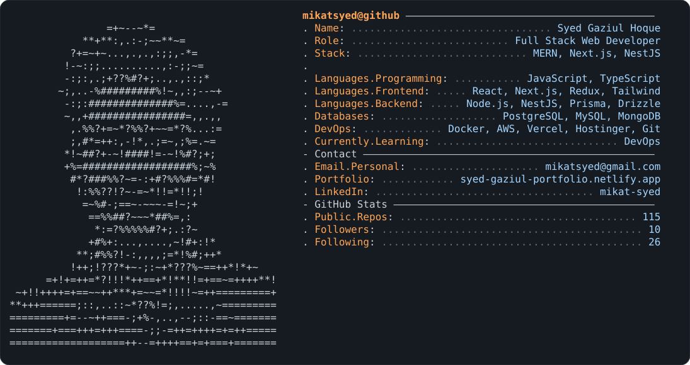

### Full Stack Web Developer building scalable, user-friendly products with the MERN stack, Next.js and Laravel

---

## About Me

I build full stack web applications end to end, from database design and REST/GraphQL APIs to fast, polished interfaces. I care about clean code, solid architecture and shipping work that clients are happy with.

- **Currently:** sharpening problem solving with Data Structures, Algorithms and LeetCode
- **Learning:** GraphQL and DevOps to improve deployment and automation pipelines
- **Ask me about:** MERN, Next.js, React Native, Electron.js, Redux, Zustand, Prisma, TypeScript and backend APIs
- **Fun fact:** I love cricket, and breaking big problems into small, elegant solutions

## Tech Stack

<table>
  <tr>
    <td width="140"><b>Languages</b></td>
    <td></td>
  </tr>
  <tr>
    <td><b>Frontend</b></td>
    <td></td>
  </tr>
  <tr>
    <td><b>Backend</b></td>
    <td></td>
  </tr>
  <tr>
    <td><b>Database & ORM</b></td>
    <td></td>
  </tr>
  <tr>
    <td><b>DevOps & Tools</b></td>
    <td></td>
  </tr>
  <tr>
    <td><b>Cross-platform</b></td>
    <td> React Native · Electron.js</td>
  </tr>
</table>

## Featured Projects

  
  

<a href="https://github.com/MikatSyed?tab=repositories">See all repositories →</a>

## GitHub Stats

  
  

  

  

---

**Let's build something great together.** Reach me at [mikatsyed@gmail.com](mailto:mikatsyed@gmail.com) or on [LinkedIn](https://linkedin.com/in/mikat-syed/).

